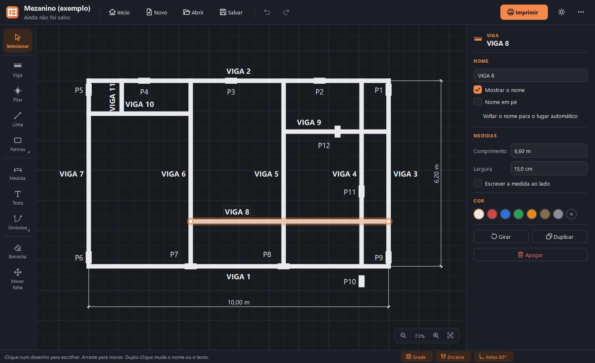
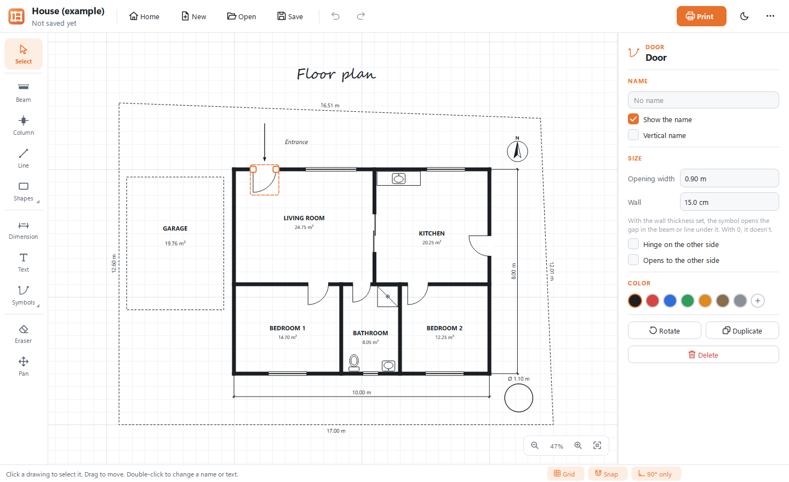
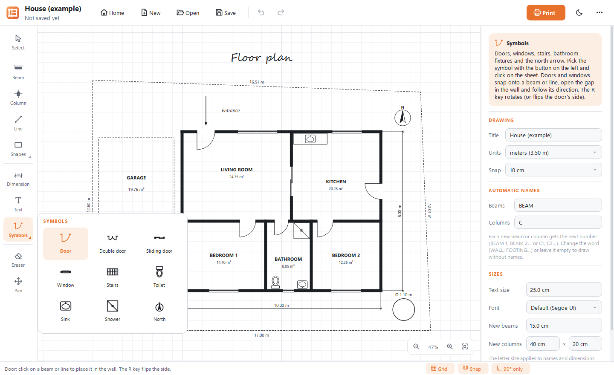

<p align="center"></p>

<h1 align="center">Autocadinho</h1>

<p align="center">
  Desenhos simples de obra (vigas, pilares, portas, janelas, medidas e textos) com as medidas certas, para salvar
  e imprimir.<br>
  <a href="#english">English below</a>
</p>


Muita planta simples de obra é feita no Paint. O resultado é bom, mas acertar as medidas, escrever
os nomes das vigas no lugar certo e imprimir do tamanho certo dá trabalho, porque o Paint não foi feito
para isso. O **Autocadinho** é um programa pequeno, gratuito e fácil, feito só para esse tipo de desenho.

- Você desenha em **centímetros de verdade**. Uma viga de 6,60 m tem 6,60 m, e as medidas são escritas sozinhas.
- Vigas e pilares ganham **nomes automáticos** (VIGA 1, VIGA 2… P1, P2…) que dá para mudar, esconder ou arrastar.
- **Portas e janelas** encaixam na parede e abrem o vão sozinhas; também há escada, louças do banheiro e o norte.
- **Formas** (retângulo, círculo, triângulo e polígono) mostram a **área em m²**, e os textos podem usar qualquer
  **fonte** do computador.
- O desenho fica **salvo** num arquivo `.cadinho` para continuar depois, e uma **cópia de segurança**
  protege o trabalho se o computador desligar.
- A **impressão** sai em A4, A3, A2, Carta ou Ofício, ajustada à folha ou numa **escala exata** (1:50, 1:100…)
  para medir no papel com a régua. Também dá para salvar em **PDF** ou **imagem** e mandar por WhatsApp.
- Tema **claro** (padrão) e **escuro**. Português e **inglês**. **Atualiza sozinho** com um clique.


## Baixar e instalar (Windows)

1. Abra a página da [última versão](https://github.com/edvitor13/autocadinho/releases/latest) e baixe o
   arquivo **`Autocadinho-…-windows-x64.msi`**.
2. Abra o arquivo baixado, marque que aceita a licença e clique em **Instalar**. Não pede senha de administrador.
3. Pronto: o Autocadinho fica no Menu Iniciar e na Área de Trabalho, e os desenhos `.cadinho` abrem com dois cliques.

> **"O Windows protegeu o computador"?** O programa não tem assinatura digital paga, então o Windows
> pode avisar na primeira vez. Clique em **Mais informações** e depois em **Executar assim mesmo**.

Prefere sem instalar? Baixe o **`.zip`**, extraia e abra o `Autocadinho.exe` de dentro da pasta.

**Atualizar:** desde a versão 1.1, quando sai uma versão nova o programa mostra o botão **Atualizar para…**;
um clique mostra as novidades, baixa, confere e instala. Também dá para instalar o `.msi` novo por cima. Os
desenhos são arquivos seus e nunca são tocados.

## Como usar

1. Na tela inicial, clique em **Novo desenho** (ou em **Ver um exemplo** para ver um desenho pronto).
2. Escolha a ferramenta na coluna da esquerda: **Viga** (arraste do começo ao fim), **Pilar** (clique),
   **Medida**, **Texto**, **Linha**, **Formas** ou **Símbolos** (portas, janelas e outros).
3. Com **Selecionar**, clique num desenho e ajuste no painel da direita: digite o comprimento certo
   (por exemplo, `3,50`), mude o nome, a cor e a espessura.
4. **Salvar** guarda o desenho. **Imprimir** mostra a folha como vai sair, com o papel e a escala.

O passo a passo completo, com todas as ferramentas e atalhos, está no **[Guia de uso](docs/GUIA.md)**
e também dentro do programa (tecla **F1**, ou o menu `⋯` › *Como usar*).

| Tela inicial | Impressão | Tema escuro |
|---|---|---|
|  |  |  |

## O que dá para desenhar

| Ferramenta | Tecla | Para quê |
|---|---|---|
| Viga | `V` | Vigas, paredes, muros e cercas, com espessura e nome automático |
| Pilar | `P` | Pilares, sapatas e caixas; encaixa nas pontas e no meio das vigas |
| Linha | `L` | Paredes finas e detalhes; pode ser tracejada e ter seta na ponta |
| Formas | `Q` `C` `G` | Retângulo, círculo, triângulo e polígono (terrenos, cômodos tortos); preenchidas, com as medidas e a área |
| Símbolos | | Porta, porta dupla, porta de correr, janela, escada, vaso sanitário, pia, chuveiro e o norte |
| Medida | `M` | Cotas: o valor é calculado e escrito sozinho (ou um texto seu) |
| Texto | `T` | Qualquer texto, em qualquer fonte, deitado ou em pé, em negrito ou itálico |
| Borracha | `E` | Apaga o que você clicar ou arrastar por cima |
| Selecionar / Mover folha | `S` / `H` | Escolher, mover, esticar; passear pela folha |

Desfazer (`Ctrl+Z`) e refazer (`Ctrl+Y`) valem para tudo. A grade, o encaixe e as retas a 90° ligam e
desligam na barra de baixo.

| Símbolos | Atualização |
|---|---|
|  |  |

## Rodar a partir do código

Precisa do [Python](https://www.python.org/downloads/) 3.12 ou mais novo.

```bat
instalar.bat     :: cria o ambiente .venv e instala o PySide6
executar.bat     :: abre o Autocadinho
```

Ou, em qualquer terminal: `python -m pip install -r requirements.txt` e `python -m autocadinho`.

## Para quem desenvolve

- [docs/DESENVOLVIMENTO.md](docs/DESENVOLVIMENTO.md): testes, traduções, capturas de tela, executável,
  instalador `.msi`, CI e como publicar uma versão.
- [docs/ARQUITETURA.md](docs/ARQUITETURA.md): como o programa é organizado por dentro.
- [docs/FORMATO.md](docs/FORMATO.md): o formato do arquivo `.cadinho` (JSON).
- [AGENTS.md](AGENTS.md): mapa rápido e regras para quem mexe no código (pessoas ou agentes de IA).
- [CHANGELOG.md](CHANGELOG.md): o que mudou em cada versão.

```bat
.venv\Scripts\python -m pip install -r requirements-dev.txt
.venv\Scripts\python -m pytest -q        :: testes, inclusive a janela usada com mouse e teclado
build.bat                                :: executável, .zip e (com o WiX) o instalador .msi
```

## Licença

[MIT](LICENSE). Pode usar, copiar, mudar e distribuir à vontade.

---

<a id="english"></a>

## English

**Autocadinho** is a small, free desktop app for simple construction floor plans: beams, columns, doors,
windows, dimension lines and text, drawn in real centimeters and printed to scale. It was made for people who
used to draw these plans in Paint and struggled with measurements, labels and printing.

- Draw in **real units**: a 6.60 m beam is 6.60 m, and dimensions are written automatically.
- Beams and columns get **automatic names** (BEAM 1, BEAM 2… C1, C2…). You can rename, hide or drag them.
- **Doors and windows** snap into walls and open the gap; there are also stairs, bathroom fixtures and a north
  arrow. **Shapes** (rectangle, circle, triangle, polygon) show their **area** in m², and texts can use any
  installed **font**.
- Drawings are **saved** as `.cadinho` files, and a **recovery copy** protects your work if the computer shuts down.
- **Print** on A4, A3, A2, Letter or Brazilian legal (Ofício), fitted to the page or at an **exact scale**
  (1:50, 1:100…), or save the sheet as **PDF** or **PNG**.
- **Light** (default) and **dark** themes. The interface is available in **Portuguese and English**:
  the app asks on first run, and you can switch at any time in the `⋯` menu › *Language*.
- **Automatic updates** (since 1.1): when a new version is out, an **Update to…** button shows what's new and
  installs it with one click, after verifying the download.

**Install (Windows):** download `Autocadinho-…-windows-x64.msi` from the
[latest release](https://github.com/edvitor13/autocadinho/releases/latest) and run it (no administrator
password needed). If Windows SmartScreen warns you, click **More info** › **Run anyway**: the app is not
signed with a paid certificate. A portable `.zip` is also available.

**Quick start:** click **New drawing**, pick a tool on the left (**Beam**: drag from start to end;
**Column**: click), then use **Select** and the panel on the right to type exact lengths, names, colors
and thicknesses. Press **F1** inside the app for the full guide, or read the
[English user guide](docs/GUIDE.md).

| Floor plan | Symbols | Print |
|---|---|---|
|  |  |  |

**From source:** Python 3.12+, then `pip install -r requirements.txt` and `python -m autocadinho`
(or `instalar.bat` and `executar.bat` on Windows). Developer docs live in `docs/` and are written in
Portuguese, like the source code. The file format is plain JSON ([docs/FORMATO.md](docs/FORMATO.md)).

Licensed under the [MIT License](LICENSE).
