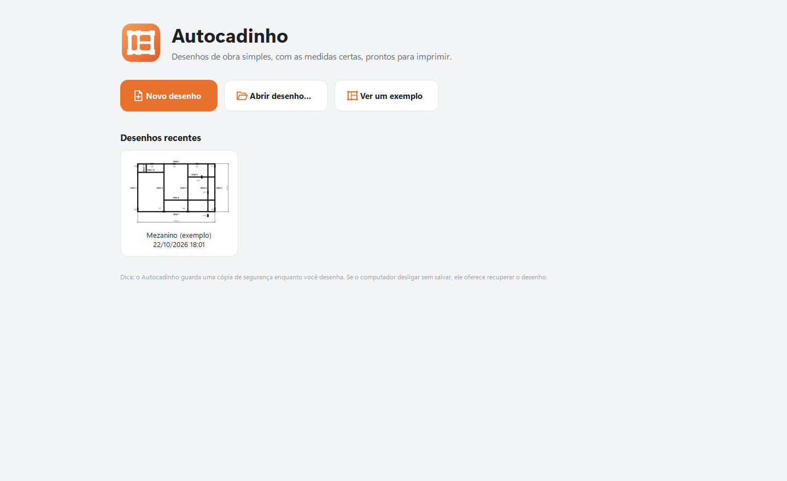
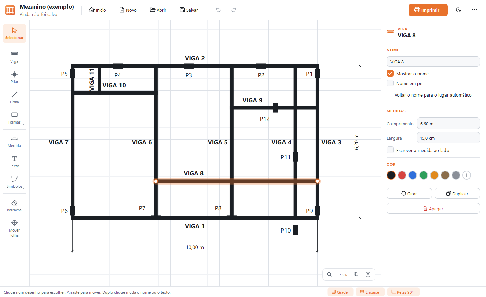
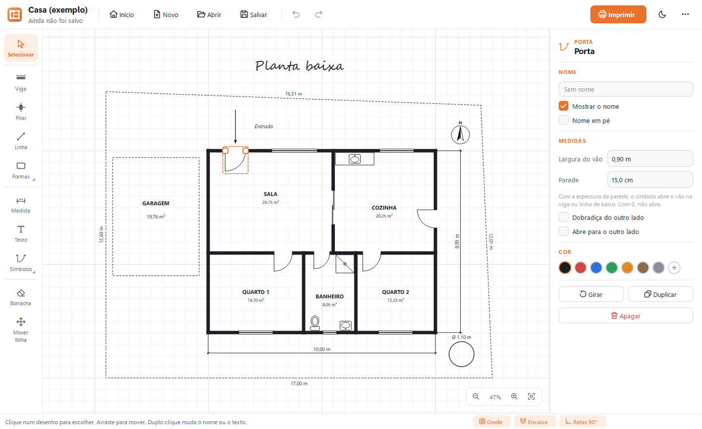
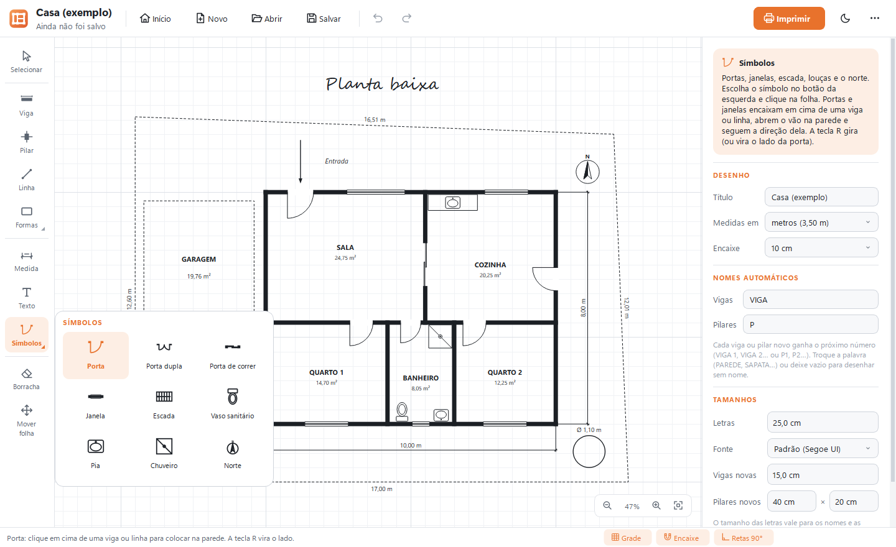
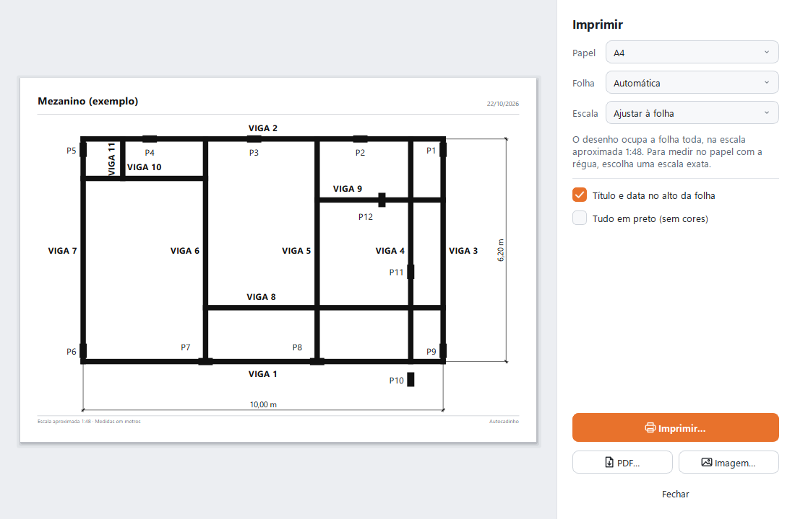
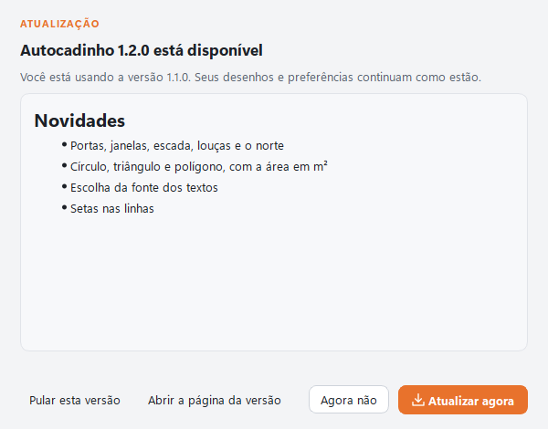

# Guia de uso do Autocadinho

Este guia explica, passo a passo, como fazer um desenho de obra no Autocadinho, salvar e imprimir.
O mesmo resumo está dentro do programa: aperte **F1** (ou abra o menu `⋯` › *Como usar*).

*English version: [GUIDE.md](GUIDE.md).*

- [1. Instalar](#1-instalar)
- [2. Abrir pela primeira vez](#2-abrir-pela-primeira-vez)
- [3. A tela inicial](#3-a-tela-inicial)
- [4. A tela de desenho](#4-a-tela-de-desenho)
- [5. Desenhando](#5-desenhando)
  - [Formas: retângulo, círculo, triângulo e polígono](#formas-retângulo-q-círculo-c-triângulo-e-polígono-g)
  - [Símbolos: portas, janelas, escada, louças e o norte](#símbolos-portas-janelas-escada-louças-e-o-norte)
- [6. Escolhendo, movendo e esticando](#6-escolhendo-movendo-e-esticando)
- [7. O painel da direita](#7-o-painel-da-direita)
- [8. Ajustes do desenho](#8-ajustes-do-desenho)
- [9. Salvando e abrindo](#9-salvando-e-abrindo)
- [10. Imprimindo, PDF e imagem](#10-imprimindo-pdf-e-imagem)
- [11. Mouse e teclado](#11-mouse-e-teclado)
- [12. Dúvidas comuns](#12-dúvidas-comuns)
- [13. Atualizações](#13-atualizações)

## 1. Instalar

1. Abra a página da [última versão](https://github.com/edvitor13/autocadinho/releases/latest) e baixe o
   arquivo que termina em **`.msi`**.
2. Abra o arquivo, marque **Aceito os termos** e clique em **Instalar**. Não precisa de senha de administrador.
3. No fim, deixe marcado **Abrir o Autocadinho agora** e clique em **Concluir**.

O programa fica no Menu Iniciar e na Área de Trabalho. Os desenhos salvos (arquivos `.cadinho`) passam a
abrir com dois cliques e aparecem no Explorador com um ícone de folha.

Se aparecer **"O Windows protegeu o computador"**, clique em **Mais informações** e depois em
**Executar assim mesmo**. O aviso aparece porque o programa não tem uma assinatura digital paga.

**Atualizar:** desde a versão 1.1, o próprio Autocadinho avisa quando sai uma versão nova e instala com um
clique (veja [Atualizações](#13-atualizações)). Também dá para baixar e instalar o `.msi` da versão nova por
cima: ele troca a versão antiga no mesmo lugar, e idioma, tema e desenhos recentes continuam como estavam.

**Desinstalar:** Configurações do Windows › Aplicativos › Autocadinho › Desinstalar. Os seus desenhos
não são apagados.

**Sem instalar:** baixe o `.zip` da mesma página, extraia a pasta e abra o `Autocadinho.exe` de dentro dela.

## 2. Abrir pela primeira vez

Na primeira vez, o Autocadinho pergunta o idioma: **Português (Brasil)** ou **English**. Dá para trocar
depois, a qualquer momento, no menu `⋯` › *Idioma*. O desenho aberto não se perde na troca.

## 3. A tela inicial

- **Novo desenho** abre uma folha em branco, já com a ferramenta Viga escolhida.
- **Abrir desenho…** procura um arquivo `.cadinho` no computador.
- **Ver um exemplo** abre a planta de um mezanino pronta, para ver como fica e experimentar à vontade.
- **Desenhos recentes** mostra os últimos desenhos salvos, com uma miniatura. Um clique abre. O botão
  direito tem *Abrir a pasta* (mostra onde o arquivo está) e *Tirar da lista*.

O botão **Início**, no alto da tela de desenho, volta para cá sem fechar o desenho.

## 4. A tela de desenho

- **Barra de cima:** Início, Novo, Abrir, Salvar, Desfazer e Refazer, o botão laranja **Imprimir**, o botão
  de tema (claro ou escuro) e o menu `⋯` (Salvar como, Salvar em PDF, Salvar como imagem, Idioma, Tema,
  exemplo, atualizações, Como usar e Sobre). Quando há versão nova, aparece também o botão
  **Atualizar para…**.
- **Coluna da esquerda:** as ferramentas. A escolhida fica destacada em laranja. **Formas** e **Símbolos**
  (os botões com um triângulo no canto) abrem um menu com as opções; o botão passa a mostrar a última escolhida.
- **Folha quadriculada:** a área de desenho. Cada quadradinho vale alguns centímetros da obra. A rodinha do
  mouse aproxima e afasta; os botões no canto de baixo também (o último mostra o desenho inteiro).
- **Painel da direita:** as medidas e os ajustes do que está selecionado. Sem nada selecionado, mostra os
  ajustes do desenho todo.
- **Barra de baixo:** à esquerda, uma dica do que fazer com a ferramenta atual; à direita, os botões
  **Grade** (quadriculado), **Encaixe** e **Retas 90°**, e a posição do mouse na obra.

## 5. Desenhando

Escolha a ferramenta na coluna da esquerda (ou pela tecla entre parênteses) e desenhe na folha.

### Viga (V)

Clique onde a viga começa e **arraste** até onde termina. Também dá para clicar no começo, soltar e clicar
no fim. Cada viga ganha um nome sozinha: VIGA 1, VIGA 2, VIGA 3…

- As vigas ficam **retas, na horizontal ou na vertical**. Para uma viga inclinada, segure **Shift** enquanto
  desenha (ou desligue **Retas 90°** na barra de baixo).
- A ponta **encaixa** nas pontas, nos meios e ao longo das outras vigas, e nos pontos da grade. Segure **Alt**
  para soltar o encaixe enquanto desenha.
- A viga serve também para paredes, muros e cercas: a espessura e o nome se mudam no painel.

### Pilar (P)

**Clique** para colocar. O pilar encaixa nas pontas, nos cantos e no meio das vigas. Antes de clicar, a tecla
**R** deixa o próximo pilar **em pé ou deitado**. Os pilares ganham os nomes P1, P2, P3…

O tamanho dos pilares novos (40 × 20 cm no começo) muda nos [ajustes do desenho](#8-ajustes-do-desenho).
Serve também para sapatas, caixas e qualquer peça retangular.

### Medida (M)

**Arraste** do começo ao fim do que quer medir. O valor (por exemplo, *6,20 m*) é calculado e escrito sozinho.
Depois, com Selecionar, arraste a **bolinha do meio** para afastar a linha da medida do desenho. No painel dá
para trocar o número por um texto seu (por exemplo, *"6,20 m (vão livre)"*).

### Texto (T)

**Clique** onde o texto vai ficar, escreva e aperte **Enter**. **Esc** cancela. Para mudar depois, dê um
**duplo clique** no texto. No painel: a **fonte** (qualquer uma instalada no computador), o tamanho das
letras, **negrito**, **itálico** e **texto em pé**. Com a fonte *A mesma do desenho*, o texto acompanha a
fonte escolhida nos [ajustes do desenho](#8-ajustes-do-desenho).

### Linha (L)

Arraste do começo ao fim. Boa para paredes finas, aberturas e detalhes. Pode ser **tracejada** e ter
**seta** no começo, no fim ou nas duas pontas (para indicar uma entrada, um caimento ou o sentido de algo).

### Formas: retângulo (Q), círculo (C), triângulo e polígono (G)

O botão **Formas** abre o menu com as quatro formas.

- **Retângulo:** clique num canto e arraste até o canto oposto (com **Shift**, um quadrado). Bom para lajes,
  aberturas e áreas.
- **Círculo:** do mesmo jeito, de um canto ao outro; com **Shift**, um círculo perfeito (sem Shift, uma elipse).
  Bom para pilares redondos, caixas d'água, poços e árvores. O círculo mostra o diâmetro (*Ø 1,10 m*).
- **Triângulo:** arraste de um canto ao outro. Depois, com Selecionar, as bolinhas mudam cada ponta.
- **Polígono:** para terrenos e formas tortas. Clique em cada canto, um depois do outro. Para terminar, clique
  no primeiro ponto (a forma fecha), dê **dois cliques** ou aperte **Enter**. **Backspace** desfaz o último
  ponto e **Esc** cancela. Com *Retas 90°* ligado, os lados ficam retos; segure **Shift** para lados inclinados.

As formas podem ser **tracejadas** e **preenchidas**, escrever as **medidas dos lados** e mostrar a **área**
em m², escrita no meio. O painel do polígono mostra também o número de pontos e o **perímetro**, e
*Fechar a forma* liga ou desliga o último lado.

### Símbolos: portas, janelas, escada, louças e o norte

O botão **Símbolos** abre o menu: **porta**, **porta dupla**, **porta de correr**, **janela**, **escada**,
**vaso sanitário**, **pia**, **chuveiro** e o **norte**. Escolha um e clique na folha.

- **Portas e janelas encaixam na parede.** Passe o mouse em cima de uma viga ou linha: o símbolo segue a
  direção dela e fica na espessura certa. Ao clicar, ele **abre o vão** na parede (o desenho da parede some
  embaixo da porta, como numa planta de verdade). Antes de clicar, a tecla **R** vira o lado para onde a
  porta abre.
- Os outros símbolos são colocados com um clique; a tecla **R** gira 90° antes de clicar.
- No painel:
  - **Portas e janelas:** a *Largura do vão*, a espessura da *Parede* (com 0, o símbolo não abre o vão),
    *Dobradiça do outro lado* e *Abre para o outro lado*. A porta de correr tem *Espelhar*.
  - **Escada:** o comprimento, a largura, o número de **degraus** (automático, um a cada 28 cm, ou o que
    você digitar) e *Inverter o sentido* da seta que mostra para onde se sobe.
  - **Louças:** largura e comprimento. **Norte:** o tamanho.
- Os símbolos também podem ter um nome, escrito no painel (por exemplo, *P1* numa porta ou *J1* numa janela),
  e têm cor, **R** para girar e as bolinhas para mudar o tamanho.

### Borracha (E) e Mover folha (H)

- **Borracha:** clique no que quer apagar, ou arraste por cima de vários de uma vez.
- **Mover folha:** arraste para ver outra parte do desenho. Em qualquer ferramenta, segure **Espaço** e
  arraste (ou arraste com o botão do meio do mouse) para fazer o mesmo.

**Esc** cancela o que está fazendo e volta para Selecionar.

## 6. Escolhendo, movendo e esticando

Com a ferramenta **Selecionar (S)**:

- **Clique** num desenho para escolher. **Shift + clique** (ou Ctrl + clique) junta mais um, ou tira da seleção.
- **Arraste num lugar vazio** para escolher tudo o que estiver dentro do retângulo. **Ctrl+A** escolhe tudo.
- **Arraste** um desenho escolhido para mover. As **setas do teclado** movem de pouquinho em pouquinho
  (com Shift, dez vezes mais).
- **Arraste as bolinhas** das pontas para esticar ou encurtar uma viga, linha ou medida, e as dos cantos para
  mudar o tamanho de um retângulo ou círculo. No triângulo e no polígono, cada bolinha é um canto. Nas portas
  e janelas, as bolinhas das pontas mudam a largura do vão. O tamanho de um pilar muda no painel.
- **Arraste o nome** de uma viga ou de um pilar para tirá-lo de cima de outro desenho. No painel, *Voltar o
  nome para o lugar automático* desfaz isso.
- **Duplo clique** muda o nome de uma viga ou pilar, ou o texto.
- **R** gira 90° o que está escolhido. **Delete** apaga. **Ctrl+C / Ctrl+V** copiam e colam; **Ctrl+D** duplica.
- O **botão direito** abre um menu com essas mesmas opções, mais *Trazer para a frente* e *Mandar para trás*.

Errou? **Ctrl+Z** desfaz (quantas vezes precisar) e **Ctrl+Y** refaz.

## 7. O painel da direita

Ao escolher um desenho, o painel mostra tudo o que dá para ajustar nele:

- **Nome:** o nome da viga ou do pilar, *Mostrar o nome* e *Nome em pé* (escrito de baixo para cima).
- **Medidas:** digite o valor exato e aperte Enter. Numa viga, o **Comprimento** muda a ponta final e mantém
  o começo e a direção; a **Largura** é a espessura desenhada. Num pilar ou retângulo, largura e altura.
  No círculo, *Círculo perfeito* e o **Diâmetro** (ou largura e altura, numa elipse).
  *Escrever a medida ao lado* mostra o comprimento junto da viga ou linha.
- **Área:** retângulos, círculos e polígonos mostram a área no painel; *Escrever a área* põe o valor no desenho.
- **Texto:** a fonte, o tamanho, negrito, itálico e texto em pé.
- **Cor:** preto (automática), vermelho, azul, verde, laranja, marrom ou cinza. O botão **+** abre *Outra cor…*
  com qualquer cor. A cor *automática* sai preta no papel e clara no tema escuro.
- **Girar**, **Duplicar** e **Apagar**.

Com vários desenhos escolhidos, o painel muda todos de uma vez: a cor, *Mostrar os nomes*, *Escrever a medida
ao lado*, e os botões Girar, Duplicar e Apagar.

## 8. Ajustes do desenho

Sem nada selecionado (clique num lugar vazio da folha), o painel mostra os ajustes do desenho todo:

- **Título:** aparece no alto da folha impressa (por exemplo, *Mezanino da loja*). Se ficar vazio, ao salvar
  ganha o nome do arquivo.
- **Medidas em:** metros (*6,20 m*) ou centímetros (*620 cm*).
- **Letras:** a altura das letras dos nomes e das medidas, em centímetros da obra.
- **Fonte:** a fonte dos nomes, das medidas e dos textos que usam *A mesma do desenho*. A lista mostra cada
  fonte escrita nela mesma. Se o desenho for aberto num computador sem a fonte, aparece *(não instalada)* e
  o programa usa uma parecida.
- **Vigas novas** e **Pilares novos:** a largura das próximas vigas e o tamanho dos próximos pilares.
- **Encaixe:** de quantos em quantos centímetros os desenhos encaixam na grade (ou *Sem grade*).
- **Nomes automáticos:** a palavra usada nos nomes das vigas e dos pilares novos. Troque *VIGA* por *PAREDE*
  ou *MURO*, *P* por *S* (sapata), ou deixe vazio para desenhar sem nome.

## 9. Salvando e abrindo

- **Salvar (Ctrl+S)** guarda o desenho num arquivo `.cadinho`. Na primeira vez, o programa pergunta o nome e
  a pasta. Depois, Salvar só atualiza o mesmo arquivo. **Salvar como…** (no menu `⋯`) faz uma cópia com outro nome.
- O título da janela ganha um **•** quando há mudanças não salvas. Ao fechar, abrir outro desenho ou começar
  um novo, o programa pergunta se quer salvar.
- **Abrir (Ctrl+O)** procura um desenho. Também dá para **arrastar** um arquivo `.cadinho` para dentro da janela
  ou dar dois cliques nele no Explorador.
- **Cópia de segurança:** enquanto você desenha, o Autocadinho guarda uma cópia a cada poucos segundos. Se o
  computador desligar sem salvar (queda de energia, por exemplo), na próxima vez ele pergunta se quer
  **Recuperar** o desenho. A cópia é apagada quando você salva ou fecha o programa normalmente.

A gravação é segura: o arquivo antigo só é trocado depois que o novo foi gravado inteiro, então um problema
no meio da gravação nunca estraga o desenho que já estava salvo.

## 10. Imprimindo, PDF e imagem

Clique no botão laranja **Imprimir** (ou **Ctrl+P**). A janela mostra a folha exatamente como vai sair:

- **Papel:** A4, A3, A2, Carta ou Ofício.
- **Folha:** *Automática* (deitada para desenhos largos, em pé para desenhos altos), *Deitada* ou *Em pé*.
- **Escala:** *Ajustar à folha* usa a folha toda. Numa escala exata, como **1:50**, dá para medir no papel com a
  régua: 1 cm no papel vale 50 cm na obra. Se o desenho não couber na escala escolhida, aparece um aviso com
  um botão para usar a maior escala que cabe.
- **Título e data no alto da folha** e **Tudo em preto (sem cores)** ligam e desligam o cabeçalho e as cores.
- **Imprimir…** abre a janela da impressora do Windows. **PDF…** e **Imagem…** salvam a folha num arquivo,
  para mandar por e-mail ou WhatsApp. O programa avisa quando terminar e oferece **Abrir agora**.

As escolhas da impressão ficam guardadas para a próxima vez. No rodapé da folha saem a escala e a unidade das
medidas.

## 11. Mouse e teclado

| Tecla ou gesto | O que faz |
|---|---|
| `S` `V` `P` `L` `Q` `C` `G` `M` `T` `E` `H` | Ferramentas: Selecionar, Viga, Pilar, Linha, Retângulo, Círculo, Polígono, Medida, Texto, Borracha e Mover a folha |
| `Esc` | Cancela o que está fazendo e volta para Selecionar |
| `Shift` (desenhando) | Viga, linha ou lado do polígono inclinado; no retângulo, um quadrado; no círculo, um círculo perfeito |
| `Alt` (desenhando ou movendo) | Solta o encaixe |
| `R` | Gira o que está selecionado (ou o próximo pilar ou símbolo; numa porta em cima da parede, vira o lado) |
| `Enter` · `Backspace` | No polígono: termina a forma e desfaz o último ponto |
| Setas | Movem o que está selecionado (com `Shift`, dez vezes mais) |
| `Delete` | Apaga o que está selecionado |
| `Ctrl+Z` · `Ctrl+Y` | Desfaz e refaz |
| `Ctrl+C` · `Ctrl+X` · `Ctrl+V` · `Ctrl+D` | Copia, recorta, cola e duplica |
| `Ctrl+A` | Seleciona tudo |
| `Ctrl+N` · `Ctrl+O` · `Ctrl+S` · `Ctrl+Shift+S` | Novo, abrir, salvar e salvar como |
| `Ctrl+P` | Imprimir |
| Rodinha do mouse · `Ctrl++` · `Ctrl+-` | Aproxima e afasta |
| `Espaço` + arrastar · botão do meio | Move a folha |
| `Ctrl+0` | Mostra o desenho inteiro |
| `F1` | Abre o *Como usar* |

## 12. Dúvidas comuns

**A viga não fica inclinada.** As retas a 90° estão ligadas. Segure **Shift** enquanto desenha, ou desligue
**Retas 90°** na barra de baixo.

**O desenho pula para um lugar que eu não quero.** É o encaixe. Segure **Alt** enquanto desenha ou move, ou
desligue **Encaixe** na barra de baixo. Para encaixes mais finos, diminua o *Encaixe* nos ajustes do desenho.

**O nome de uma viga ficou em cima de outra coisa.** Com Selecionar, arraste o nome para outro lugar.

**Como faço uma viga com a medida exata?** Desenhe mais ou menos do tamanho, escolha a viga e digite o
comprimento certo no painel (por exemplo, `3,50` com metros, ou `350` com centímetros).

**Na impressão aparece "O desenho não cabe na folha".** Use o botão que sugere a maior escala que cabe, escolha
um papel maior ou volte para *Ajustar à folha*.

**Como mando o desenho por WhatsApp?** Na janela de impressão, clique em **PDF…** ou **Imagem…** e envie o
arquivo salvo. Para alguém continuar o desenho em outro computador com o Autocadinho, envie o arquivo `.cadinho`.

**Apaguei sem querer.** **Ctrl+Z** desfaz, mesmo depois de vários passos.

**O computador desligou e eu não tinha salvado.** Abra o Autocadinho de novo e clique em **Recuperar**.

**A porta não abriu o vão na parede.** Ela precisa ser colocada em cima de uma viga ou linha (o símbolo gira
sozinho quando está em cima dela). Se já foi colocada fora, arraste para cima da parede e confira a
espessura da *Parede* no painel: com 0, o vão não abre.

**Como escrevo a área de um cômodo?** Desenhe um retângulo (ou um polígono, se o cômodo for torto) por cima do
cômodo e marque *Escrever a área*. Para o contorno não se confundir com as paredes, deixe-o tracejado ou
com uma cor clara.

## 13. Atualizações

Ao abrir, no máximo uma vez por dia, o Autocadinho pergunta ao GitHub qual é a última versão. **Nada é
enviado**: é a mesma consulta que o navegador faz ao abrir a página de versões.

- Quando há versão nova, aparece o botão **Atualizar para…** no alto e um aviso na tela inicial.
- Um clique mostra as **novidades**. **Atualizar agora** baixa o instalador, **confere** o arquivo com a soma
  SHA-256 publicada junto (se não conferir, nada é instalado) e pergunta se pode fechar. Se houver desenho sem
  salvar, o programa pergunta antes, como sempre. Depois ele instala e **abre de novo sozinho**.
- **Pular esta versão** esconde o aviso até sair a próxima. **Agora não** só fecha a janela.
- No menu `⋯`: **Procurar atualizações…** consulta na hora, e **Procurar atualizações sozinho** liga ou desliga
  a busca automática.

Quem instalou pelo `.msi` recebe o `.msi` novo; quem usa o `.zip` recebe o `.zip` novo, na mesma pasta.
A versão 1.0 ainda não tinha esse recurso: para sair dela, baixe a versão nova uma vez pela página e
instale por cima.
