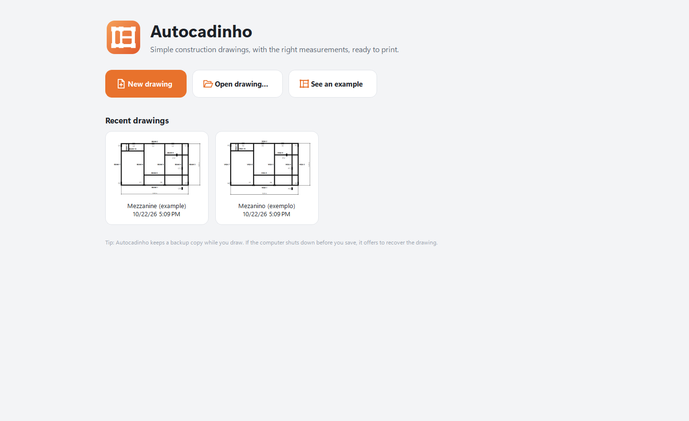
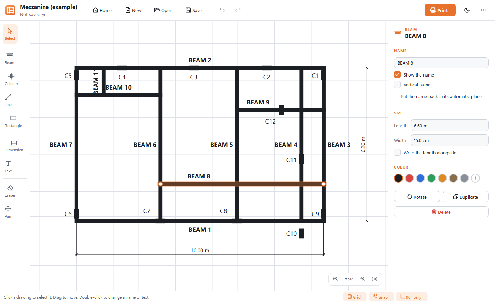
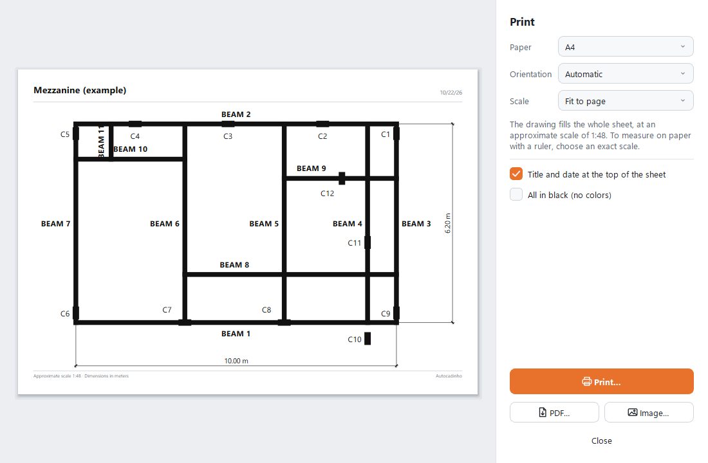

# Autocadinho user guide

How to draw a simple construction plan in Autocadinho, save it and print it. The same summary is
available inside the app: press **F1** (or open the `⋯` menu › *How to use*).

*Versão em português: [GUIA.md](GUIA.md).*

## 1. Install

1. Download the file ending in **`.msi`** from the
   [latest release](https://github.com/edvitor13/autocadinho/releases/latest).
2. Run it, accept the license and click **Install**. No administrator password is needed.
3. At the end, keep **Open Autocadinho now** checked and click **Finish**.

The app is added to the Start menu and the desktop, and saved drawings (`.cadinho` files) open with a
double click. If Windows shows **"Windows protected your PC"**, click **More info** › **Run anyway**: the app
is not signed with a paid certificate.

The installer itself is in Portuguese (the app's main audience), but the app is fully translated.

- **Update:** install the newer `.msi` over the old one. It replaces the old version in the same folder and
  keeps your language, theme and recent drawings.
- **Uninstall:** Windows Settings › Apps › Autocadinho › Uninstall. Your drawings are never deleted.
- **Portable:** download the `.zip`, extract it and run `Autocadinho.exe` from the extracted folder.

## 2. First run and language

On first run, Autocadinho asks for the language: **Português (Brasil)** or **English**. You can switch at any
time in the `⋯` menu › *Language*; the open drawing is kept. Automatic names follow the language of new
drawings (**BEAM 1**, **C1** in English; **VIGA 1**, **P1** in Portuguese).

## 3. Home screen

**New drawing** opens a blank sheet with the Beam tool selected. **Open drawing…** looks for a `.cadinho`
file. **See an example** opens a finished mezzanine plan to explore. **Recent drawings** shows your last
saved drawings with a thumbnail; right-click a card for *Open folder* and *Remove from list*.

## 4. The drawing screen

- **Top bar:** Home, New, Open, Save, Undo, Redo, the orange **Print** button, the theme button and the `⋯`
  menu (Save as, Save as PDF, Save as image, Language, Theme, example, How to use, About).
- **Left column:** the tools. **Grid paper:** the drawing area, in real centimeters. The mouse wheel zooms;
  the buttons in the bottom corner also zoom and show the whole drawing.
- **Right panel:** exact sizes and settings of the selection (or of the whole drawing when nothing is selected).
- **Bottom bar:** a hint for the current tool, the **Grid**, **Snap** and **90° only** toggles, and the mouse
  position.

## 5. Drawing

| Tool | Key | How |
|---|---|---|
| Beam | `V` | Drag from start to end (or click, then click again). Beams get automatic names. Hold **Shift** for a sloped beam. Also good for walls and fences. |
| Column | `P` | Click to place. Snaps to beam ends, corners and midpoints. **R** turns the next column upright or sideways. Also good for footings and boxes. |
| Dimension | `M` | Drag across what you want to measure. The value is written automatically; drag the middle handle to move the dimension line away. |
| Text | `T` | Click, type and press **Enter** (**Esc** cancels). Double-click to edit later. |
| Line | `L` | Drag from start to end. Can be dashed. Stairs, openings, details. |
| Rectangle | `Q` | Drag from corner to corner (**Shift**: square). Can be dashed, filled and show its sizes. Slabs, areas. |
| Eraser | `E` | Click what you want to delete, or drag over several things. |
| Pan | `H` | Drag to move the sheet. In any tool, hold **Space** and drag (or use the middle mouse button). |

Points **snap** to ends, midpoints, along other beams and to the grid; hold **Alt** to release the snap.
**Esc** cancels and goes back to Select.

## 6. Selecting, moving and resizing

With **Select** (`S`): click to select; **Shift+click** (or Ctrl+click) adds or removes; drag on an empty spot
to select everything inside the box; **Ctrl+A** selects all. Drag to move; the **arrow keys** nudge (with
Shift, ten times more). Drag the end handles of beams, lines and dimensions, and the corner handles of
rectangles. Drag a beam's or column's **name** to move it off other drawings. Double-click edits a name or a
text. **R** rotates 90°, **Delete** deletes, **Ctrl+C / Ctrl+V / Ctrl+D** copy, paste and duplicate, and the
right-click menu also has *Bring to front* and *Send to back*. **Ctrl+Z** undoes and **Ctrl+Y** redoes.

## 7. The right panel

- **Name:** the beam or column name, *Show the name*, *Vertical name*, *Put the name back in its automatic place*.
- **Size:** type exact values and press Enter. A beam's **Length** moves its end point and keeps its start and
  direction; **Width** is its drawn thickness. Columns and rectangles have width and height.
  *Write the length alongside* shows the length next to a beam or line.
- **Color:** automatic (black on paper, light in the dark theme), red, blue, green, orange, brown, gray, or
  **+** for any other color.
- **Rotate**, **Duplicate** and **Delete**. With several things selected, the panel changes all of them at once.

With nothing selected, the panel shows the **drawing settings**: *Title* (printed at the top of the sheet),
*Units* (meters or centimeters), *Text size* for names and dimensions, the size of *New beams* and
*New columns*, the *Snap* step (or *No grid*), and the **Automatic names**: change BEAM to WALL, C to F, or
leave it empty to draw without names.

## 8. Saving and opening

**Save** (`Ctrl+S`) writes a `.cadinho` file; **Save as…** (in the `⋯` menu) makes a copy. The window title
shows a **•** while there are unsaved changes, and the app asks before closing or opening another drawing.
You can also drag a `.cadinho` file onto the window.

While you draw, Autocadinho keeps a **recovery copy** a few seconds after each change. If the computer shuts
down without saving, the next start offers to **Recover** the drawing. Saving is atomic: the old file is only
replaced after the new one is completely written.

## 9. Printing, PDF and image

Click **Print** (`Ctrl+P`). The preview shows exactly what will come out.

- **Paper:** A4, A3, A2, Letter or Brazilian legal (216 × 330 mm).
- **Orientation:** *Automatic* (landscape for wide drawings), *Landscape* or *Portrait*.
- **Scale:** *Fit to page* uses the whole sheet. An exact scale such as **1:50** lets you measure the paper with
  a ruler (1 cm on paper = 50 cm on site). If the drawing does not fit, a button offers the largest scale that fits.
- *Title and date at the top of the sheet* and *All in black (no colors)*.
- **Print…** opens the Windows printer dialog. **PDF…** and **Image…** save the sheet to a file, ready to send
  by e-mail or chat.

## 10. Keyboard and mouse

| Key | Action |
|---|---|
| `S` `V` `P` `L` `Q` `M` `T` `E` `H` | Select, Beam, Column, Line, Rectangle, Dimension, Text, Eraser, Pan |
| `Esc` | Cancel and go back to Select |
| `Shift` while drawing | Sloped beam or line; square rectangle |
| `Alt` while drawing or moving | Release the snap |
| `R` | Rotate the selection (or turn the next column) |
| Arrows | Nudge the selection (`Shift`: ten times more) |
| `Delete` | Delete the selection |
| `Ctrl+Z` · `Ctrl+Y` | Undo and redo |
| `Ctrl+C` · `Ctrl+X` · `Ctrl+V` · `Ctrl+D` | Copy, cut, paste, duplicate |
| `Ctrl+A` | Select all |
| `Ctrl+N` · `Ctrl+O` · `Ctrl+S` · `Ctrl+Shift+S` | New, open, save, save as |
| `Ctrl+P` | Print |
| Mouse wheel · `Ctrl++` · `Ctrl+-` | Zoom in and out |
| `Space` + drag · middle button | Move the sheet |
| `Ctrl+0` | Show the whole drawing |
| `F1` | How to use |
